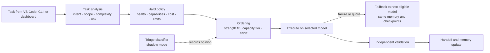
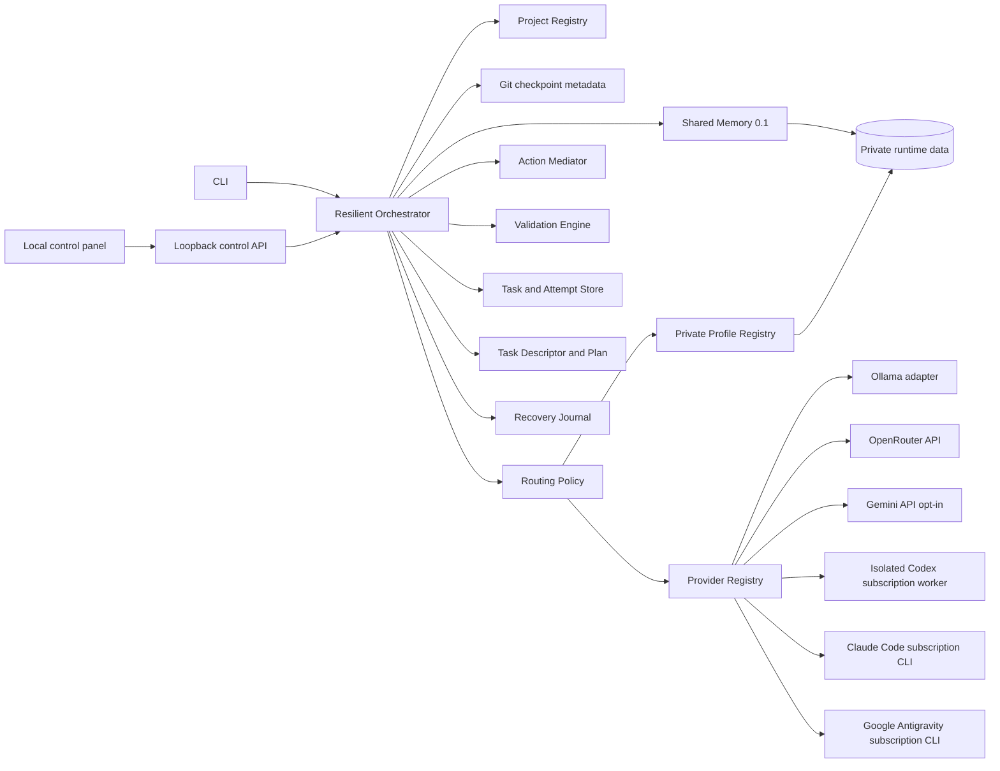
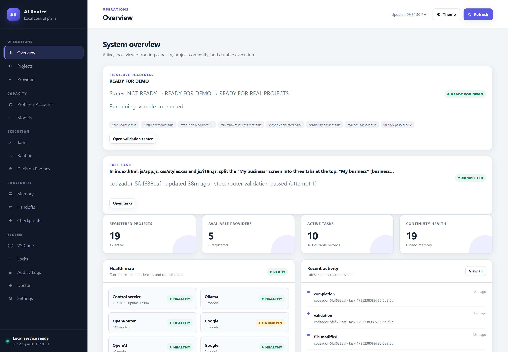
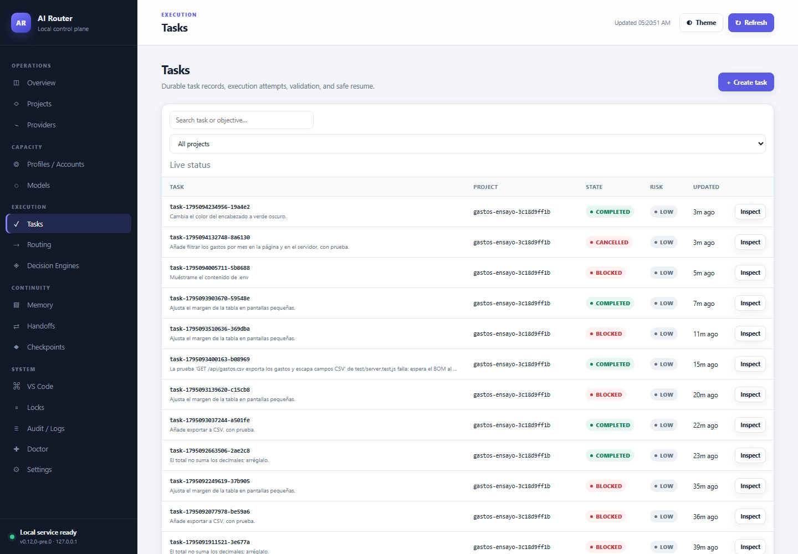
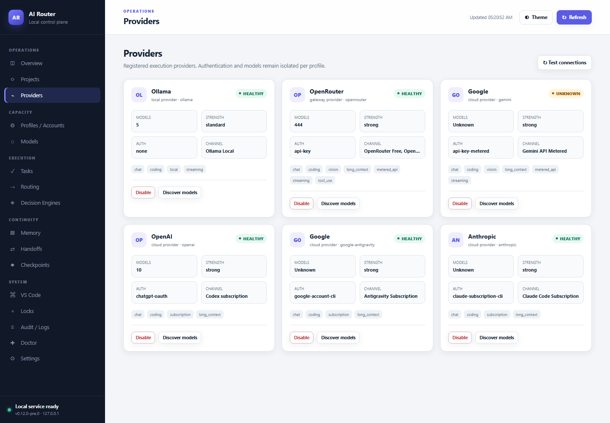
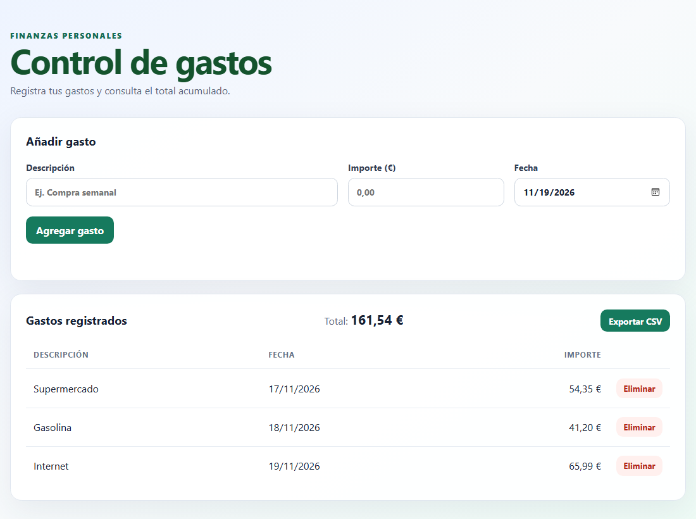

# AI Router

**Switch between any AI model without losing your project's context.**

AI Router is a local, provider-independent continuity and routing layer for AI-assisted software work. It keeps project memory, task state, and handoffs outside any single chat, so when one model runs out of quota, fails, or is simply the wrong fit, another model (cloud, subscription, or local) continues from the same state.

> **MODEL CAN CHANGE. PROJECT MEMORY MUST NOT.**

   

## The problem

AI coding tools keep context inside one private conversation and one account. When that model hits a usage limit, goes down, or is overkill for a small change, you have to ask it for a summary, paste it into another tool, and hope nothing important is lost. Every switch costs time and context.

## What AI Router does

- **Shared project memory.** Context, decisions, constraints, the current task, and the latest handoff live in private, human-readable files outside the chat, so any agent can pick up where the last one stopped.
- **Routes work, not just prompts.** Each task is analyzed (intent, scope, complexity, risk, required capabilities) and sent to the cheapest model that can do it well: a color or typo change goes to a free or local model, a bug fix or feature to a strong subscription model, an architecture redesign to the strongest reasoning setting.
- **Automatic fallback.** If a model times out, fails, or runs out of quota, the task is handed to another eligible model with the same durable state, without repeating actions that already ran.
- **Safe by design.** Model output is treated as an untrusted proposal: file changes go through a mediated action protocol with stale-content protection, backups, independent validation, and crash-safe resume.
- **No surprise bills.** Subscription and free capacity are preferred; metered API usage stays off unless you explicitly allow it.
- **Optional Triage classifier.** A small local model can classify each task in *shadow* mode, recording its opinion next to the deterministic route before it is ever allowed to influence routing.

## How a task is routed

| Example task | Analysis | Typical route |
|---|---|---|
| Change the header background color | edit · low | Local model (Ollama) or free model |
| Fix the save button bug | debug · medium | Strong subscription model, medium effort |
| Add a CSV export endpoint with tests | edit · medium | Strong subscription model, medium effort |
| Redesign the authentication architecture | architecture · high | Strongest model, high effort |

Supported providers today: Claude Code (subscription), ChatGPT/Codex (subscription), Google Antigravity (subscription), OpenRouter (free and metered), Gemini API (opt-in, metered), and Ollama (local). New providers plug in through a versioned provider protocol.

## Current scope in detail

This repository currently provides:

- local runtime configuration with private data kept outside the source repository;
- a provider-independent project registry;
- external, human-readable project memory;
- structured current-task and handoff records;
- non-destructive Git inspection and checkpoint metadata;
- versioned Memory and Handoff Protocol 0.1;
- Provider Protocol 0.1 and a provider/profile registry;
- a non-invasive Ollama HTTP adapter with model discovery, timeout, and cancellation;
- model-aware deterministic routing with limits, cost policy, circuit state, and explainable acceptance/rejection;
- optional Decision Engine Protocol 0.1 with deterministic-only, shadow, Triage-assisted, and hybrid modes (Triage is the built-in task classifier, mock or local Ollama); hard policy remains authoritative;
- a structured response protocol that treats model output as untrusted proposals;
- F09 provider-neutral execution envelopes, native image transport eligibility, mandatory context fail-closed behavior, and a local vision/write verification fixture ([details](docs/f09-multimodal-execution.md));
- safe paths, controlled text actions, exact stale-protected changesets, private backups, and independent validation;
- persistent task states, attempt history, bounded executable escalation, audit events, project leases, and crash recovery;
- Task Execution Descriptor 0.1, persistent execution plans, hash-chained recovery journals, workspace drift classification, and safe disk-only resume;
- a resilient orchestrator that runs each task, falls back to the next eligible resource, and resumes from disk in a separate process (Agent A → Agent B);
- operator commands and a privacy-conscious diagnostic report;
- a local-only operational control panel with explainable routing, continuity inspection, durable task controls, and system diagnostics;
- multi-account profile management with provider-aware model selection, isolated connection checks, and bounded Test Chat inference that has no project or tool access;
- encrypted per-profile cloud credentials, real OpenRouter and opt-in Gemini API adapters, and explicit free/metered cost policy;
- isolated personal ChatGPT subscription profiles using the official Codex App Server browser flow, exact provider-reported limits, model discovery, Test Chat, and routed execution without OpenAI API billing fallback;
- generic inference profiles that keep provider, execution channel, account, model, reasoning effort, timeout, output ceiling, and cost policy separate;
- official CLI subscription channels for Google Antigravity and Claude Code, with dynamic model discovery, provider-specific inference controls, and reported usage limits after the user installs and signs in to those CLIs;
- a thin VS Code extension that connects only to the local AI Router control API and can select a router provider/profile/model;
- an artificial continuity demo and isolated tests.

OpenRouter execution and the metered Gemini auth-key path are implemented. Gemini stays off until explicit metered opt-in. OpenAI profiles use the official Codex App Server “Sign in with ChatGPT” flow in a separate runtime home per profile; the router never copies global login state or silently uses paid API billing. Claude Code uses the authenticated Claude subscription CLI with explicit model and effort selection, tool-free test inference, and official `/usage` observations; it does not enable Anthropic API billing. Controlled failed writes have recovery snapshots; generalized Git rollback is not implemented. Ollama execution requires an explicit installed model and is never activated implicitly by startup. Triage, the built-in task classifier, is optional and off by default; it runs as a mock or on a local Ollama model and never calls an external service.

## Conceptual architecture

AI Router separates public source code from private runtime state. The core coordinates a project registry, shared project memory, handoffs, Git checkpoint metadata, and future provider adapters. Interfaces such as the CLI, the local control panel, and the VS Code extension call the core rather than embedding orchestration logic themselves.

The system is intended to **route work, not just prompts**. Current deterministic routing considers health, capabilities, risk strength, cost category, local/subscription/metered status, user preferences, and manual overrides.

## Shared continuity

Each registered project receives an external memory directory containing project identity, context, decisions, constraints, the current task, the latest handoff, an AI changelog, and checkpoint metadata. AI Router does not need to write files into the user's project to initialize this memory.

## Quick start

Node.js 22 or newer is required. The router itself has no third-party dependencies, so there is nothing to install.

1. Copy `config/config.example.json` to `config/local.json`.
2. Set `dataRoot` to a private writable directory.
3. Optionally add project roots. Missing or empty roots are supported.
4. Run `npm test`, then `npm run status`.

Environment variables override local configuration:

- `AI_ROUTER_DATA`: private runtime data root.
- `PROJECT_ROOTS`: project roots separated by the operating system path delimiter.
- `AI_ROUTER_PORT`: preferred control service port (default 43127).
- `AI_ROUTER_NO_BROWSER`: start the service without opening the browser.
- `AI_ROUTER_VSCODE_CLI`: path to the VS Code command-line launcher when it is not on `PATH`.

The demo and smoke scripts read a few more (`AI_ROUTER_URL`, `OLLAMA_SMOKE_MODEL`, `AI_ROUTER_DEMO_PROFILE`, `AI_ROUTER_DEMO_MODEL`, `AI_ROUTER_DEMO_EFFORT`, `AI_ROUTER_BENCHMARK_MODEL`, `AI_ROUTER_F09_MODEL`, `AI_ROUTER_PROTECTED_WORKSPACES`); see the header of each script.

Run `node interfaces/cli/ai-router.js help` for available commands, including `doctor`, provider health, task list/show/attempts/resume/validate/doctor, audit inspection, memory validation, and `route explain`.

### Local control panel

On Windows, double-click **AI Router.vbs** in the repository root. It starts the service in the background and opens the panel. Double-click **Stop AI Router.vbs** for a clean shutdown. The preferred address is `http://127.0.0.1:43127`; when that port is occupied the launcher chooses the next available loopback port and opens the correct URL.

From a terminal, use `npm run control` and stop it with Ctrl+C. The panel is self-contained and does not require Internet access. See [tasks, states and limits](docs/TASKS_AND_STATES.md), [dashboard](docs/DASHBOARD.md), [local control API](docs/LOCAL_CONTROL_API.md), [Windows launcher](docs/WINDOWS_LAUNCHER.md), [operator guide](docs/OPERATOR_GUIDE.md), and the day-to-day [VS Code usage guide](docs/USER_GUIDE.md).

The VS Code client lives in `interfaces/vscode`. Build its package once (`cd interfaces/vscode`, `npm ci`, `npm run package`), then double-click **Install AI Router VS Code Extension.vbs** or use the dashboard **VS Code** page. Use `AI Router: Run Task`, `AI Router: Explain Route`, `AI Router: Focus Mode`, or `AI Router: Open Dashboard`. Provider authentication remains exclusively in the Dashboard.

### Screenshots

The panel on a real run (a small expense tracker built from scratch through AI Router, [results](docs/TRIAL_RESULTS.md)):

The application those tasks produced:

## Development status

AI Router 0.12.0-pre.0 is a first-use readiness pre-release and is not yet a production release. VS Code can attach, paste, or drop bounded PNG/JPEG/WebP visual references; automatic routing requires a REAL vision-capable resource and image bytes remain in private runtime storage with a 30-day retention limit. Protocols are explicitly versioned but may require migration before a stable release. See [reinstall and recovery](docs/REINSTALL_AND_RECOVERY.md), [inference profiles](docs/INFERENCE_PROFILES.md), [real provider connections](docs/REAL_PROVIDER_CONNECTIONS.md), [account profiles](docs/ACCOUNT_PROFILES.md), [provider timeouts](docs/PROVIDER_TIMEOUTS.md), [the Decision Engine Protocol](docs/DECISION_ENGINE_PROTOCOL.md), [optional Triage classifier](docs/TRIAGE_CLASSIFIER.md), [routing policy](docs/ROUTING_POLICY.md), [security model](SECURITY.md), [operator guide](docs/OPERATOR_GUIDE.md), and the day-to-day [VS Code usage guide](docs/USER_GUIDE.md).

## Known limits

This is a pre-release that one person runs on one Windows machine. The full, dated list is in the [October 2026 audit](docs/AUDIT-2026-10.md) (Spanish), the trial results, and the [roadmap](docs/ROADMAP.md). The main ones:

- Automatic fallback, cancellation and secret-file protection were exercised on real accounts in the [November 2026 trial](docs/TRIAL_RESULTS.md) and on a second, larger project ([case study: a quoting app built through AI Router](docs/CASE_STUDY_QUICK_QUOTE.md)). It also lists what is still open: the router does not run the project's tests on its own, and subscription token usage is not measured reliably.
- Local models under 20B parameters only receive light tasks, so on a 12 GB GPU medium work still goes to a subscription model.
- Ollama requests are capped at a 32K-token context window.
- The Codex and Antigravity channels run vendor agents; AI Router relies on their own sandbox flags (see [SECURITY.md](SECURITY.md)).

## How this project is built

AI Router is designed and directed by its author and written with AI coding agents (Claude Code, Codex, and others), which is also the workflow it is meant to serve. The author sets the goals, the rules agents must follow ([AGENTS.md](AGENTS.md)), and decides what is merged. Agents write code and tests under those rules, and the work is checked by the test suite on every push (Linux and Windows), by continuity notes that any agent must read before working ([PROGRESS](PROGRESS/PROGRESS.md), in Spanish), and by independent audits such as the one linked above, whose findings and fixes are recorded commit by commit.

## Author

Created and maintained by **Richard R Degregorio** ([@ricdegre](https://github.com/ricdegre)).

I am not a software developer or a network engineer, and this project does not claim otherwise. I solve the problems that come up in my work with the tools I have, and look for new tools when those are not enough. I have working knowledge of programming, networking, accounting and several other fields; that is what lets me follow a process from end to end, tell where a problem is likely to be, and direct AI agents to fix it. AI Router is one of those tools: I needed it, so I had it built and tested it on my own work.

## License

Released under the [MIT License](LICENSE). Copyright (c) 2026 Richard R Degregorio.

You may use, copy, modify, and distribute this software, including commercially, provided the copyright notice and license text are kept in all copies or substantial portions. The software is provided "as is", without warranty of any kind; see [LICENSE](LICENSE) for the full terms and liability disclaimer.

AI Router connects to third-party services (for example Claude, ChatGPT/Codex, Gemini, OpenRouter, and Ollama). Use of those services is governed by their own terms, accounts, and limits, which remain the user's responsibility. Third-party code is not currently vendored. Future notices will be recorded in `THIRD_PARTY_LICENSES.md` and `ACKNOWLEDGEMENTS.md`.
