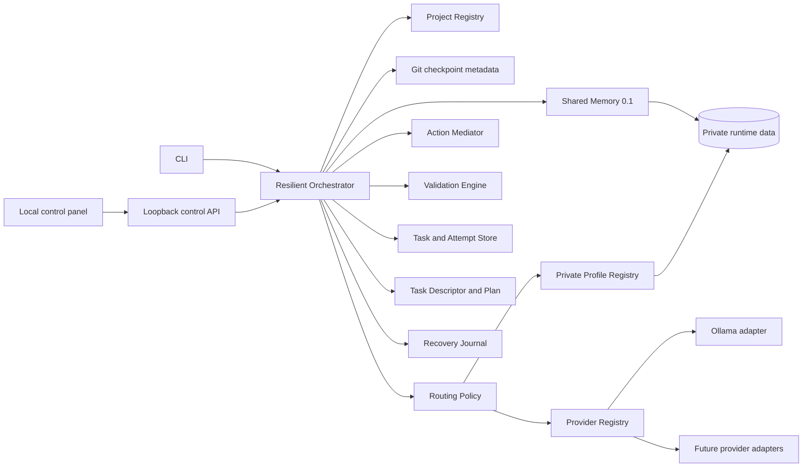

# AI Router

AI Router is an early-stage, provider-independent continuity platform for AI-assisted project work.

AI tools often preserve context inside one private conversation, account, or provider. When that resource becomes unavailable, reaches a limit, or is inappropriate for the next task, work continuity breaks. AI Router is being built so another compatible agent can safely continue from shared operational state without needing the previous agent's private chat history.

> **MODEL CAN CHANGE. PROJECT MEMORY MUST NOT.**

## Current scope

This repository currently provides:

- local runtime configuration with private data kept outside the source repository;
- a provider-independent project registry;
- external, human-readable project memory;
- structured current-task and handoff records;
- non-destructive Git inspection and checkpoint metadata;
- versioned Memory and Handoff Protocol 0.1;
- Provider Protocol 0.1 and a provider/profile registry;
- a non-invasive Ollama HTTP adapter with model discovery, timeout, and cancellation;
- model-aware deterministic routing with limits, cost policy, circuit state, and explainable acceptance/rejection;
- optional Decision Engine Protocol 0.1 with deterministic-only, mocked Jev-assisted, and hybrid modes; hard policy remains authoritative;
- a structured response protocol that treats model output as untrusted proposals;
- safe paths, controlled text actions, exact stale-protected changesets, private backups, and independent validation;
- persistent task states, attempt history, bounded executable escalation, audit events, project leases, and crash recovery;
- Task Execution Descriptor 0.1, persistent execution plans, hash-chained recovery journals, workspace drift classification, and safe disk-only resume;
- a continuity orchestrator tested across isolated Agent A and Agent B instances, including a live local Ollama stage;
- operator commands and a privacy-conscious diagnostic report;
- a local-only operational control panel with explainable routing, continuity inspection, durable task controls, and system diagnostics;
- an artificial continuity demo and isolated tests.

Real cloud-provider execution, OpenAI/Gemini/Claude account authentication, automatic rollback, and real TypeSafe/Jev connectivity are **not implemented**. Cloud providers and real Jev connection are shown only as explicit placeholders. Ollama execution requires an explicit installed model and is never activated implicitly by startup. Jev is optional, mocked, and off by default.

## Conceptual architecture

AI Router separates public source code from private runtime state. The core coordinates a project registry, shared project memory, handoffs, Git checkpoint metadata, and future provider adapters. Interfaces such as the CLI and a future VS Code panel call the core rather than embedding orchestration logic themselves.

The system is intended to **route work, not just prompts**. Current deterministic routing considers health, capabilities, risk strength, cost category, local/subscription/metered status, user preferences, and manual overrides.

## Shared continuity

Each registered project receives an external memory directory containing project identity, context, decisions, constraints, the current task, the latest handoff, an AI changelog, and checkpoint metadata. AI Router does not need to write files into the user's project to initialize this memory.

## Quick start

Node.js 20 or newer is required. No third-party packages are needed.

1. Copy `config/config.example.json` to `config/local.json`.
2. Set `dataRoot` to a private writable directory.
3. Optionally add project roots. Missing or empty roots are supported.
4. Run `npm test`, then `npm run status`.

Environment variables override local configuration:

- `AI_ROUTER_DATA`: private runtime data root.
- `PROJECT_ROOTS`: project roots separated by the operating system path delimiter.

Run `node interfaces/cli/ai-router.js help` for available commands, including `doctor`, provider health, task list/show/attempts/resume/validate/doctor, audit inspection, memory validation, and `route explain`.

### Local control panel

On Windows, double-click **AI Router.vbs** in the repository root. It starts the service in the background and opens the panel. Double-click **Stop AI Router.vbs** for a clean shutdown. The preferred address is `http://127.0.0.1:43127`; when that port is occupied the launcher chooses the next available loopback port and opens the correct URL.

From a terminal, use `npm run control` and stop it with Ctrl+C. The panel is self-contained and does not require Internet access. See [dashboard](docs/DASHBOARD.md), [local control API](docs/LOCAL_CONTROL_API.md), [Windows launcher](docs/WINDOWS_LAUNCHER.md), and [operator guide](docs/OPERATOR_GUIDE.md).

## Development status

AI Router 0.6.0-pre.0 is in early development and is not production-ready. Protocols are explicitly versioned but may require migration before a stable release. See [the Decision Engine Protocol](docs/DECISION_ENGINE_PROTOCOL.md), [optional Jev integration](docs/JEV_INTEGRATION.md), [routing policy](docs/ROUTING_POLICY.md), [security model](SECURITY.md), and [operator guide](docs/OPERATOR_GUIDE.md).

## License

MIT. Third-party code is not currently vendored. Future notices will be recorded in `THIRD_PARTY_LICENSES.md` and `ACKNOWLEDGEMENTS.md`.
