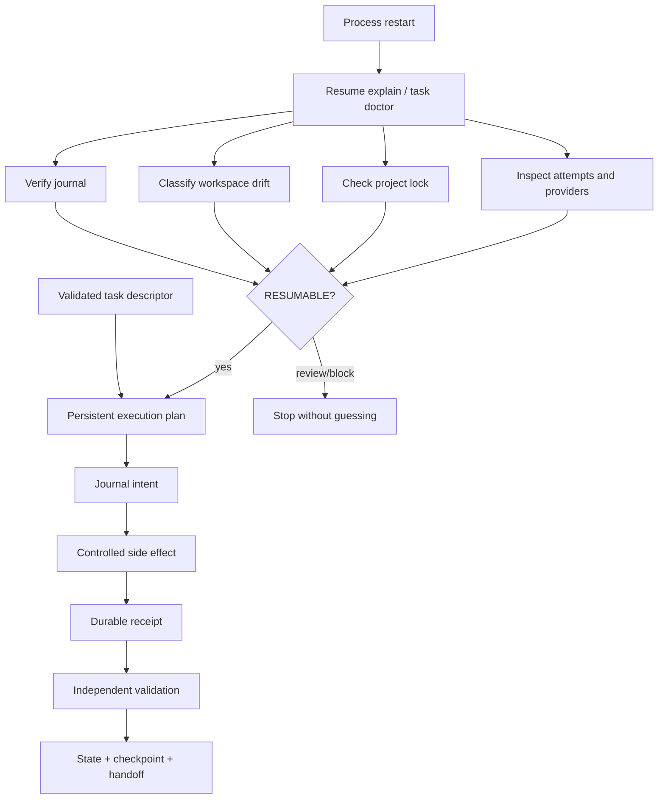
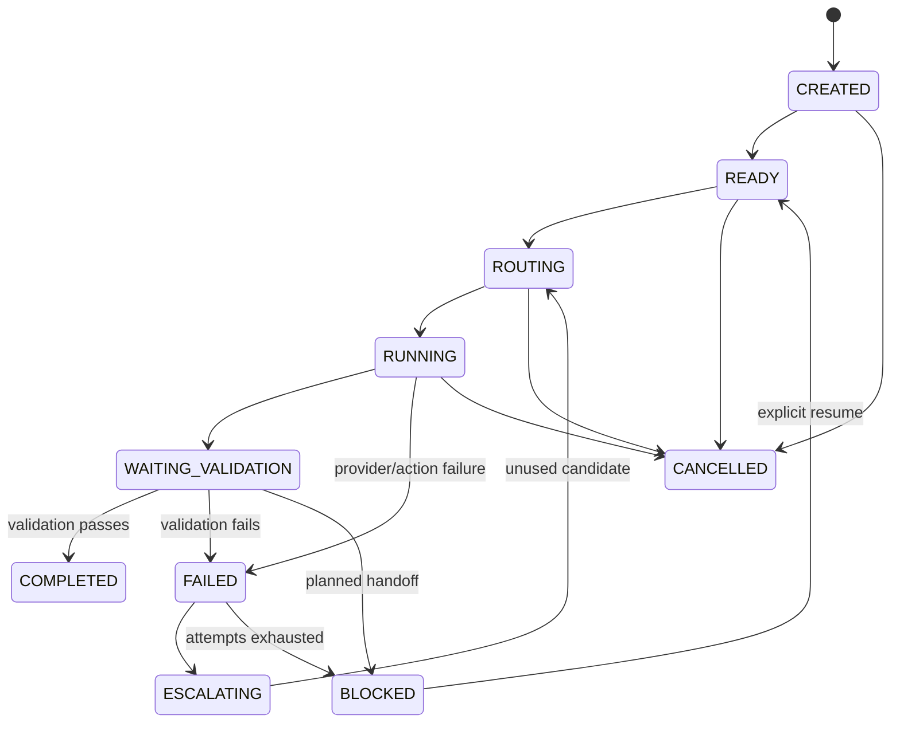
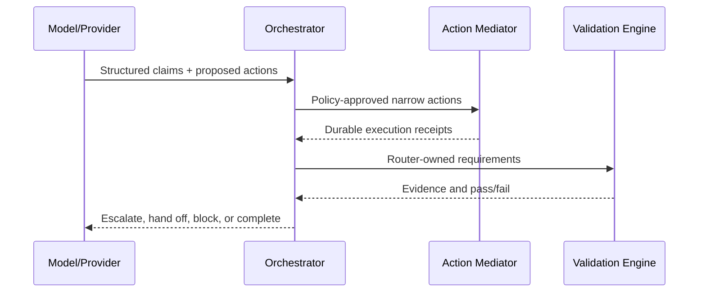

# Architecture

## Principles

**MODEL CAN CHANGE. PROJECT MEMORY MUST NOT.**

**ROUTE WORK, NOT JUST PROMPTS.**

AI Router is split into a public source repository and a private runtime data root. User projects remain independent of both. Core services must not depend on a particular provider or interface.

## Components

1. **Configuration** resolves the source root, private runtime root, and zero or more project roots. Environment variables may override an ignored local configuration file.
2. **Project Registry** discovers candidate directories without modifying them, assigns stable IDs, and preserves missing projects as inactive records.
3. **Shared Project Memory** stores layered, human-readable operational state outside the project workspace.
4. **Handoff Service** records enough structured state for a new agent to continue without private chat history.
5. **Checkpoint Service** reads Git state and records non-destructive checkpoint metadata. It never performs automatic rollback.
6. **Provider Adapters** expose normalized availability, authentication modes, capabilities, usage, execution, cancellation, and health information. Ollama is the first adapter.
7. **Account Profiles** reference independently addressable provider resources without storing passwords in the project registry or memory.
8. **Policy Engine** deterministically chooses a capable resource based on risk, availability, strength, cost category, and explicit preferences.
9. **Interfaces** call core services. The CLI is the first interface; VS Code, a local API, desktop, or web interfaces may follow.
10. **Structured Responses** normalize model claims and proposed actions without granting execution authority.
11. **Action Mediator** enforces safe paths, allowed action types, source hashes, backups, and dry-run behavior.
12. **Validation Engine** evaluates router-owned acceptance requirements independently from provider claims.
13. **Resilient Orchestrator** persists states and attempts, coordinates one writer per project, escalates through bounded candidates, and reconstructs work after interruption.
14. **Audit and Diagnostics** expose operational evidence without private prompts or secret fields.
15. **Task Execution Descriptor** persists complete task policy and execution limits independently of process memory.
16. **Execution Plan and Recovery Journal** preserve step progress and intent/receipt evidence across crashes.
17. **Resume Manager** validates state, journal, drift, locks, checkpoints, providers, attempts, and safety matrix before reconstructing work.

## Data flow

A safe work cycle is: resolve configuration → identify project → inspect memory and repository → record a checkpoint → execute through a provider → validate → update memory and handoff. Routing must select a complete work path, including safety and validation, rather than forward an isolated prompt.

## Dependency direction

Interfaces depend on core services. Core services depend on configuration and storage abstractions. Provider adapters depend on provider-specific clients, but the core depends only on adapter contracts. Private runtime data never becomes a source-code dependency.

## Current implementation

The platform implements configuration, locked registries, Memory/Handoff Protocol 0.1, Task Execution Descriptor 0.1, Recovery Journal 0.1, persistent execution plans, Git checkpoint metadata, Provider and Structured Response Protocol 0.1, private profiles, model-aware Ollama execution, deterministic routing, controlled actions, independent validation, bounded escalation, drift-aware disk-only resume, diagnostics, CLI, mocks, and multiprocess tests. Cloud authentication remains deferred.

