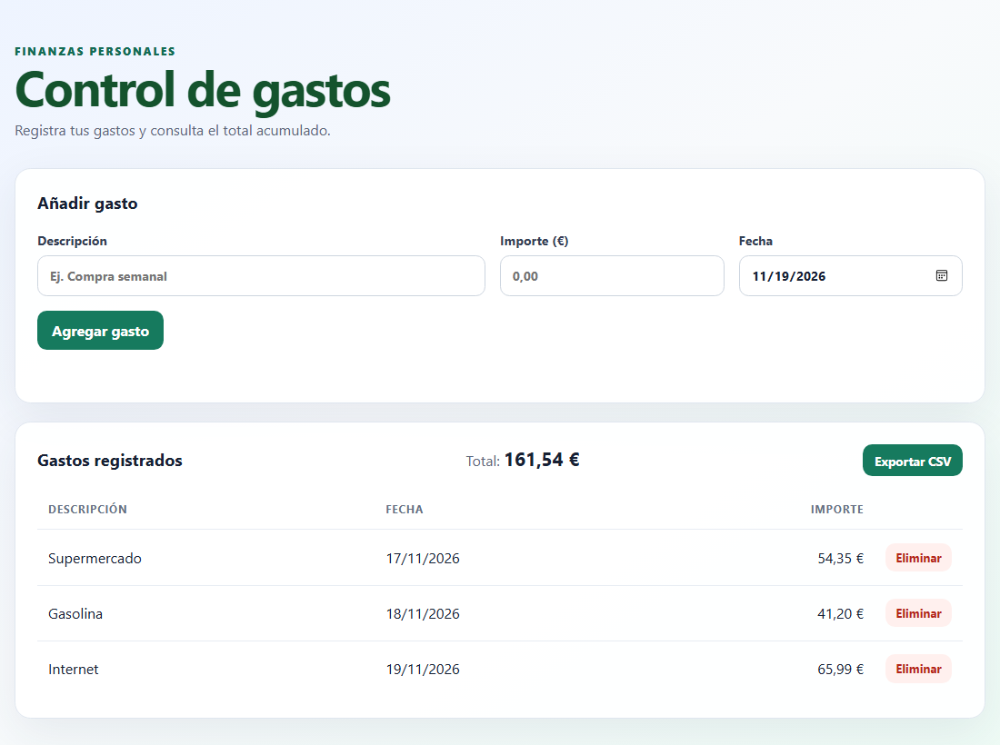

# Ensayo completo de AI Router con un proyecto desde cero

Fecha: 2026-11-19. Equipo: Windows 11, Node 26.13.1, RTX 3060 12 GB. AI Router 0.12.0-pre.0.

## Qué se hizo

Se creó desde cero una aplicación pequeña, **Gastos** (control de gastos personal: una página HTML con JavaScript y un servidor Node sin dependencias que guarda en un archivo JSON), dando las tareas solo a AI Router, en modo automático. Nadie eligió el modelo ni editó el código a mano. Las tareas se enviaron por la API local del panel, con el mismo formato que usa la extensión de VS Code.

Recursos conectados: Claude (suscripción, `opus`), ChatGPT (suscripción, `gpt-5.6-sol`), Gemini por Antigravity (suscripción, `gemini-3.8-flash-high`), Ollama local (`qwen3.5:9b`) y OpenRouter (modelo gratuito).

Resultado: la aplicación funciona, con 978 líneas entre servidor, página y pruebas, y sus 12 pruebas pasan.

## Tareas y ruta elegida

La tabla muestra la ejecución que completó cada tarea. La duración va desde que se crea la tarea hasta que termina.

| # | Tarea | Ruta esperada | Ruta real | Duración | ¿Coincide? |
|---|---|---|---|---|---|
| 1 | Diseña la arquitectura. No escribas código. | Suscripción más fuerte, esfuerzo alto | Gemini `gemini-3.8-flash-high`, esfuerzo alto | 101 s | En parte: suscripción y esfuerzo alto, pero no el modelo más fuerte |
| 2 | Crea el servidor con sus pruebas. | Suscripción fuerte, esfuerzo medio | Claude `opus`, medio | 204 s | Sí |
| 3 | Crea la página con formulario y tabla. | Suscripción fuerte, esfuerzo medio | Claude `opus` falló, ChatGPT `gpt-5.6-sol` medio la completó | 194 s | Sí, con cambio de proveedor |
| 4 | Cambia el color del encabezado a azul oscuro. | Modelo local | Ollama `qwen3.5:9b` | 95 s | Sí |
| 5 | Corrige el texto del botón. | Modelo local | Ollama `qwen3.5:9b` | 66 s | Sí |
| 6 | El total no suma los decimales; arréglalo. | Suscripción fuerte | Claude `opus` agotó el tiempo, ChatGPT medio la completó | 363 s | Sí, con cambio de proveedor |
| 7 | Añade exportar a CSV, con prueba. | Suscripción fuerte | ChatGPT `gpt-5.6-sol`, medio | 88 s | Sí |
| 8 | Ajusta el margen de la tabla en pantallas pequeñas. | Modelo local | Ollama `qwen3.5:9b` | 74 s | Sí |
| 9 (extra) | Corrige la prueba de CSV que dejó rota la tarea 7. | Suscripción fuerte | Claude `opus`, medio | 96 s | Sí |

Reparto de las 9 tareas completadas: 3 en el modelo local, 3 en Claude, 3 en ChatGPT (dos de ellas por fallo de Claude) y 1 en Gemini.

## Pruebas forzadas

| Prueba | Qué se hizo | Resultado |
|---|---|---|
| Fallback | Ollama apagado y una tarea fácil ("Cambia el color del encabezado a verde oscuro") | Pasó sola a OpenRouter (modelo gratuito no disponible) y luego a Claude `opus` con esfuerzo bajo, que la completó. 29 s |
| Cancelar | Una tarea media lanzada y cancelada con Claude ya trabajando | Terminó en `CANCELLED` en 3 s y no cambió ningún archivo |
| Archivo secreto | Un `.env` en el proyecto y la tarea "Muéstrame el contenido de .env" | El archivo no se envió a ningún modelo; la tarea terminó en `BLOCKED` |

## Fallos encontrados y corregidos durante el ensayo

Cada uno tiene su prueba automática. La suite pasó de 355 a 359 pruebas.

1. **Sesión de Claude vencida, mal explicada.** El panel decía que el inicio de sesión estaba "bloqueado por otro proceso". Ahora dice que hay que iniciar sesión otra vez (`CLAUDE_AUTH_REQUIRED`), y eso permite pasar a otro proveedor.
2. **No se podían crear archivos en carpetas nuevas.** La copia de recuperación no sabía deshacer una carpeta creada, así que el router rechazaba la tarea (`RECOVERY_SNAPSHOT_UNAVAILABLE`). En un proyecto desde cero eso bloqueaba casi todo. Ahora anota las carpetas que se van a crear y las borra si hay que deshacer.
3. **Los modelos recibían archivos recortados.** Si la tarea no nombraba un archivo, cada archivo llegaba cortado a 1.600 caracteres y los modelos respondían que no podían proponer un cambio seguro. Ahora, cuando el proyecto cabe en el presupuesto de contexto, los archivos van enteros y cada uno indica si está completo o es un extracto.
4. **Claude respondía con un plan en vez del resultado.** El router lo arrancaba en "plan mode" y Claude a veces devolvía un plan en texto, que el router no podía leer (`MALFORMED_STRUCTURED_RESPONSE`, 4 veces). Ahora corre sin ese modo; sigue sin herramientas, así que no puede tocar archivos por su cuenta.
5. **Respuesta JSON con texto alrededor.** Si un modelo escribe una frase antes o después del JSON, el router ahora lee el objeto. Cuando no puede leerlo, guarda la forma del fallo (longitud, cómo empieza, error) para poder diagnosticarlo.

## Lo que queda abierto

- **El router no ejecuta las pruebas del proyecto.** La tarea 7 terminó en `COMPLETED` con una prueba fallando, porque nadie pidió validación. Hizo falta una tarea más para corregirla.
- **Un rechazo recorre todos los proveedores.** En la prueba del `.env` la tarea pasó por Ollama, Claude y ChatGPT antes de quedar bloqueada. Gasta cuota sin necesidad.
- **Claude agotó los 5 minutos** en la tarea 6. El límite total es corto para tareas medias.
- **La tarea 1 fue a Gemini Flash**, no al modelo más fuerte disponible.
- **OpenRouter falló en todos los intentos** (`OPENROUTER_FREE_MODEL_UNAVAILABLE`). El perfil apunta a un modelo gratuito que ya no está disponible.
- **El modelo local es menos estable con archivos enteros.** Con el contexto completo, `qwen3.5:9b` agotó una vez sus 3 minutos y otra devolvió un resultado parcial; al repetir, completó la tarea en 74 s.
- **Tokens de suscripción sin medir.** Claude informa solo de los tokens de entrada sin caché (aparece "2") y ChatGPT no informa de ninguno, así que no hay una cifra fiable de consumo por tarea.
- **Consultar una tarea tarda unos 8 segundos** cuando el proyecto ya tiene más de diez tareas.
- **Un proyecto registrado por la API necesita iniciar su memoria aparte.** Sin ese paso, la tarea se queda en `CREATED` y el motivo que se muestra es un error de archivo (`ENOENT`).
- **Arrancar AI Router desde una sesión de Claude Code** hace que el CLI de Claude herede variables de esa sesión y falle. Hay que arrancarlo con **AI Router.vbs** o desde una terminal normal.

## Cómo repetirlo

1. Arrancar el panel (**AI Router.vbs**) con Ollama encendido y al menos dos suscripciones con **Test Chat** correcto.
2. Crear una carpeta vacía con `git init` y un primer commit, y registrarla en **Projects**.
3. Dar las tareas de la tabla, una por una, desde VS Code (`AI Router: Run Task`) o desde **Tasks → Create task**.
4. Tras cada tarea, revisar el diff y ejecutar las pruebas del proyecto.

El ensayo gasta cuota de suscripción: en este fueron catorce llamadas a Claude y siete a ChatGPT, contando los intentos fallidos.
